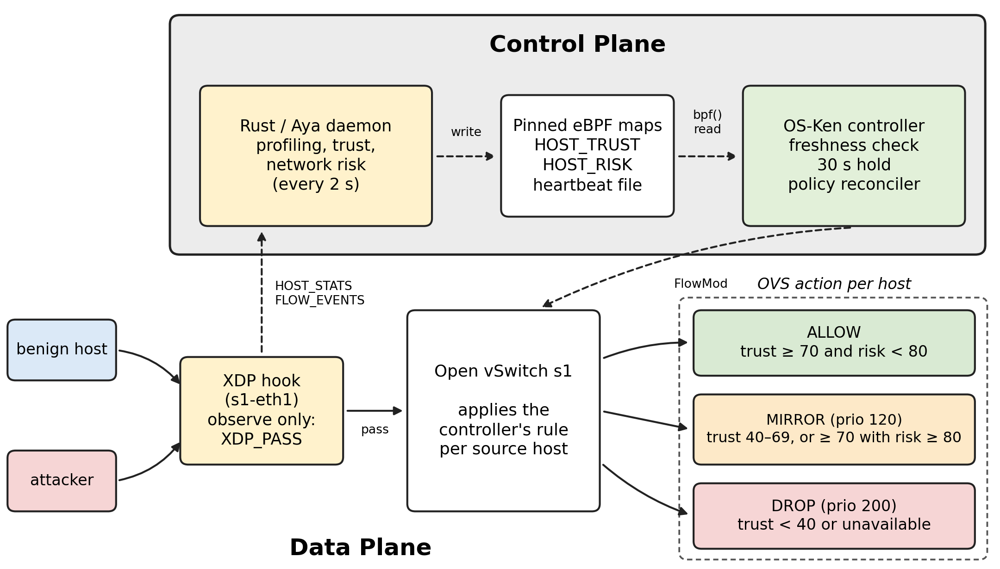

# **Active Defense Gateway (ADG): Proactive Network Camouflage and Deception in Software-Defined Infrastructures**

## **Project Status: Phase 1 Completed (Intelligent Trust-Based SDN)**

The Active Defense Gateway has successfully completed **Phase 1** of its implementation. ADG has evolved from a theoretical framework into a fully functional, closed-loop, adaptive security system capable of high-speed telemetry, behavioral profiling, and dynamic OpenFlow enforcement.

### **Phase 1 Accomplishments**
- **Observation Plane (eBPF/XDP):** High-performance, in-kernel telemetry tracking packets, bytes, TCP/UDP/ICMP ratios, SYN floods, and **Fragmented Packet (Evasion)** anomalies.
- **Trust Engine (Rust):** A mathematically rigorous, stateless behavioral profiler that translates network telemetry into a dynamic 0-100 `HOST_TRUST` score.
- **Enforcement Plane (Python OS-Ken):** An SDN controller that polls the Trust Engine without executing heavy logic, triggering dynamic OpenFlow `FlowMod` rules.
- **Adaptive Policy States:** Hosts transition between `ALLOW`, `MIRROR`, and `DROP` based on their real-time behavior: trust < 40 → `DROP`; 40–69 → `MIRROR`; ≥ 70 → `ALLOW`, escalated to `MIRROR` when network risk ≥ 80. Risk never weakens `MIRROR` or `DROP`.
- **Background Reconciliation:** Every 2 s the controller re-evaluates trust and risk for all known hosts and updates OpenFlow rules idempotently, without waiting for a `PacketIn`.
- **Telemetry Freshness:** The daemon publishes a heartbeat; the controller detects stale telemetry and replaced pinned maps, holds the last valid value for at most 30 s, then applies explicit degraded actions (trust unavailable → `DROP`). Failures never become trust 100 / risk 0.
- **Evaluation:** Unit/integration tests (Rust and Python), live acceptance tests (daemon restart and SIGKILL during `DROP`), and a live network-intelligence campaign; thesis figures are generated from recorded evidence by `results/plot_live_figures.py`.
- **Network Intelligence Layer:** Real-time event streaming (`PerfEventArray`) mapping TCP control events (`SYN`, `FIN`, `RST`) to userspace for continuous, non-blocking flow and graph analysis.
- **Network Risk Score (auxiliary):** A `SecurityGraph` and flow table feed a 0–100 risk score; risk ≥ 80 can escalate an otherwise allowed host to `MIRROR` only. In 30 live trials the maximum observed risk was 50 and benign and attack scores overlapped, so risk-driven enforcement has been validated only with injected values (see `results/risk_threshold_limitation.md`).

---

## **1. Problem Statement**

The evolution of network security has reached a critical inflection point where traditional reactive measures are no longer sufficient to combat the sophistication of modern adversarial tactics. The fundamental architecture of current enterprise networks suffers from a condition known as Static Topology Persistence. In these environments, once an adversary breaches the initial perimeter defense, they encounter an internal landscape that is predictable, unchanging, and largely transparent. Servers maintain fixed IP addresses, critical services listen on standard ports, and the network graph remains consistent over long durations. This structural stability provides a significant asymmetric advantage to the attacker, who can conduct extensive reconnaissance and lateral movement with minimal risk of detection.

Internal reconnaissance is the foundational phase of the cyber kill chain. Attackers utilize automated scanning tools to map the network, identifying live hosts, open ports, and operating system versions. In a static network, the information gathered during this phase remains valid indefinitely. 

Current security solutions fail to address the simultaneous requirements for high-speed packet processing and deep architectural intelligence. Legacy firewalls operate with high performance but lack contextual awareness. Standard responses like "dropping" traffic are binary and provide zero intelligence to the defender.

There is a critical need for a system that can actively deceive attackers at wire speed, invalidating their reconnaissance data and disrupting the lateral movement process. This project proposes an Active Defense Gateway (ADG) that utilizes Software-Defined Networking (SDN) and kernel-resident eBPF programs to implement "Cognitive Network Camouflage."

## **2. Architecture Overview**



### **2.1 The Three-Plane Security Model**

* **Observation Plane (eBPF/XDP):** Sitting directly on the Network Interface Card (NIC), this Rust-based eBPF program parses packet headers (including IPv4 fragmentation flags) at wire speed. It maintains a `HOST_STATS` map tracking granular behaviors like SYN ratios and fragment counts.
* **Control Plane (Rust Userspace):** The "Trust Engine" reads the telemetry, builds a `HostProfile`, and calculates a `TrustScore` (0-100). This score is pinned to a global eBPF map (`/sys/fs/bpf/HOST_TRUST`).
* **Enforcement Plane (SDN Controller):** The Python-based `OS-Ken` controller reads the pinned trust and risk maps via `ctypes`. A stateless `PolicyEngine` determines the action (`ALLOW`, `MIRROR`, `DROP`), and a `FlowInstaller` pushes OpenFlow rules to the switches. The XDP program only observes (`XDP_PASS`); all enforcement happens in Open vSwitch.

## **3. Advanced Threat Mitigation**

The ADG evaluates traffic continuously, allowing it to adapt to complex, multi-stage attacks:

* **SYN-Heavy Traffic:** Detected via the TCP SYN ratio in each 2 s window. A moderate ratio costs 20 points (still `ALLOW`); an aggressive ratio costs 50 points (trust 50 → `MIRROR`). SYN behaviour alone does not lead to `DROP`.
* **Fragmented Packet Evasion (Teardrop / Ping of Death):** Tools like `hping3 -f` use fragmentation to bypass IDSs. ADG's eBPF parser natively detects IPv4 `More Fragments (MF)` flags and non-zero offsets; more than 5% fragmented packets in a window costs 85 points (trust 15 → OpenFlow `DROP`).
* **`MIRROR`:** Traffic keeps flowing and a 128-byte copy is sent to the controller, which currently discards it. No IDS is integrated, so `MIRROR` marks a host but does not inspect or contain its traffic.
* **Known limitation — pulsing attackers:** Trust is computed from the last 2 s window, so it recovers as soon as an attack pauses. Persistent reputation (decay) is not implemented and remains future work.

## **4. Quick Start / Installation**

### **Prerequisites**
- Ubuntu 22.04 LTS (or compatible Linux)
- Rust Toolchain (`cargo`, `rustc`)
- Python 3.10+ with `os-ken` installed
- Mininet & Open vSwitch (OVS)

### **Compiling the eBPF Observation Plane**
```bash
cd adg-xdp
cargo build --release
sudo target/release/adg-xdp --iface <network_interface>
```
*Note: The Rust daemon must be run with `sudo` to pin the `HOST_TRUST` map to the sysfs.*

### **Running the Python Enforcement Plane**
```bash
osken-manager controller/adg_controller.py
```

### **Generating Evaluation Metrics (Thesis Validation)**
Thesis figures are regenerated from recorded experiment evidence (needs `matplotlib` and `tcpdump`):
```bash
python3 results/plot_live_figures.py
```
Live acceptance tests (root; each detaches and writes evidence under `results/live_acceptance/`):
```bash
sudo python3 tests/live_restart_during_drop.py
sudo python3 tests/live_sigkill_outage.py
```
The older `results/simulate_*.py` scripts produce synthetic plots based on an obsolete five-tier policy and are not used by the thesis.

## **5. Roadmap**

- [x] **Phase 1:** Intelligent Trust-Based SDN (eBPF Telemetry, Trust Engine, Dynamic OpenFlow)
- [x] **Phase 1.5:** Live Network Intelligence (PerfEventArray Streaming, Network Risk Scoring, Dynamic Security Graph)
- [x] **Phase 2:** Multi-controller SDN (EQUAL-role controllers, failover, PacketIn deduplication; no state synchronization)
- [ ] **Phase 3:** Active Deception (Honeypots, Tarpits, moving target defense logic)
- [ ] **Phase 4:** AI-assisted Trust (ML models, anomaly detection enhancements)
- [ ] **Phase 5:** Production Hardening (Scalability tests, Kubernetes deployment)

## **6. License**
Dual MIT/GPL - See individual source files for details.
